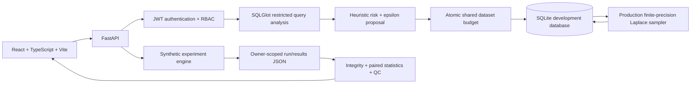

# PrivacyGuard architecture

PrivacyGuard is a research prototype with two deliberately separate paths: a
restricted protected-query API backed by application data, and an isolated
synthetic experiment engine. The research engine does not call the production
release path and does not read registered datasets.

## Runtime components

## Production protected-query flow

1. FastAPI authenticates the caller and checks operation permissions and the
   dataset role grant.
2. SQLGlot parses and constrains supported aggregate SQL. The API compiles the
   accepted structure to bound SQLAlchemy operations; it does not execute the
   submitted SQL string.
3. The release path determines query type, sensitivity, configured SUM bounds,
   dataset version, authorization scope, policy version and selected epsilon.
4. It checks for an exact compatible release. A hit returns the stored noisy
   output and does not reserve more budget.
5. A new release reserves the shared dataset budget with a conditional update,
   computes the aggregate, clips SUM contributions as configured, samples
   noise, and persists the release, ledger, query history and audit event in
   one transaction. Failures roll back the reservation and release writes.
6. A uniqueness conflict from concurrent identical submissions is resolved by
   rolling back and retrieving the winning compatible release.

The application development database defaults to SQLite. PostgreSQL driver and
Alembic dependencies exist, but PostgreSQL deployment/migration is not an
established or verified project capability. Consult
[`docs/privacy_accounting.md`](docs/privacy_accounting.md),
[`docs/mathematical_model.md`](docs/mathematical_model.md) and
[`docs/laplace_sampler_audit.md`](docs/laplace_sampler_audit.md) for the
accounting and sampler limits. Ledger epsilon is nominal and uncertified; no
formal end-to-end DP guarantee is claimed.

## Isolated synthetic research flow

`POST /api/experiments/runs` requires `experiments:run`. The engine generates
synthetic employee records in memory from a seeded generator, builds a fixed
scenario workload, and compares selected M0–M5 configurations on matched trial
seeds. It uses a deterministic experiment-only Laplace helper; production
randomness and the production database release ledger are not involved in the
simulated baselines. The run configuration stores Protocol V2, versioned
definitions, seed schedule, baseline settings and execution environment.

The API persists run and baseline result JSON in `experiment_runs` and
`experiment_results`. Run retrieval and CSV export are owner-scoped and require
the experiment permission. Persisted evidence contains synthetic target and
inference evidence and request error/accounting summaries, not raw aggregate
answers or employee rows. Validation is read-only for persisted results;
quality classification and paired statistics are derived from the stored
protocol/evidence. Historical rows are not assigned new protocol definitions.

## Repository map

- `backend/app/auth`, `rbac`, `users`: identity, role and permission checks.
- `backend/app/query`, `privacy`, `budget`: restricted SQL analysis, release
  mechanism, policy signals and nominal accounting.
- `backend/app/datasets`: registered synthetic dataset management and separate
  in-memory experiment generation.
- `backend/app/experiments`: protocol, synthetic workloads/baselines,
  persistence routes, integrity validation, statistics and quality control.
- `frontend/src`: authenticated application, research pages and API services.
- `docs`: protocol, mathematical/accounting assumptions, threat model,
  limitations and operator guides.

See [`docs/reproducibility_manifest.md`](docs/reproducibility_manifest.md) for
the observed toolchain and dependency-lock status, and
[`docs/RESEARCH_PROTOCOL_V2.md`](docs/RESEARCH_PROTOCOL_V2.md) for the
experiment protocol definition.
