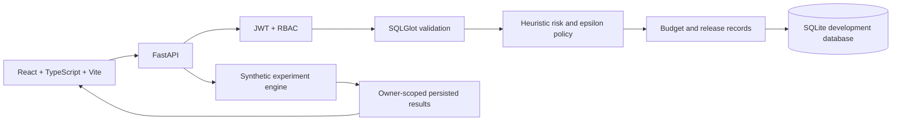

# PrivacyGuard

**Query-History-Aware Adaptive Differential Privacy Middleware for Multi-Level Enterprise Databases**

PrivacyGuard is an academic research prototype for controlling supported aggregate queries, tracking nominal privacy expenditure, reusing exact protected releases, and studying query-history-aware epsilon allocation. It combines a restricted SQL workflow, authentication/RBAC, audit records, synthetic attack evaluation, and comparative experiment tools. It is not a certified differential privacy product or a production-ready enterprise database gateway.

## Research problem and proposed approach

Role-based access control determines who may query a database, but authorized aggregate outputs can still reveal information when combined across repeated or related queries. PrivacyGuard explores a middleware design that analyzes a restricted query, applies a configured privacy mechanism, tracks nominal expenditure, and uses query history and a heuristic risk policy to propose epsilon allocations. Its research question is whether that adaptive policy can change the privacy-utility trade-off under predeclared synthetic workloads.

The contribution under study is the integration and evaluation of history-aware allocation. The project does not claim a new DP mechanism, a proof for adaptive composition, or a formal end-to-end privacy guarantee.

## Current implementation

- Authenticated FastAPI API with role and permission checks.
- React/TypeScript research and operations interface.
- Restricted COUNT and bounded SUM query support; submitted SQL text is parsed and compiled to constrained SQLAlchemy operations rather than executed verbatim.
- Shared per-dataset nominal budget, release records, exact-release reuse, query history, and audit events.
- Synthetic employee dataset generation and a separate in-memory seeded experiment engine.
- Six synthetic comparison configurations, attack scenarios, integrity checks, paired analysis, and owner-scoped saved-run retrieval/export.
- Separate contextual literature records. Published literature is not pooled with synthetic measurements.

CSV import, arbitrary SQL, AVG/grouped query protection, PostgreSQL production setup, production migrations, background experiment jobs, and concurrent API benchmarking are not established features.

## Architecture



The protected-query path and the synthetic research engine are separate. Experiments do not read the registered application dataset or call the production query-release path. See [ARCHITECTURE.md](ARCHITECTURE.md), [API documentation](docs/api_documentation.md), and [database design](docs/database_design.md).

## Technology stack

- Python 3.11+, FastAPI, Uvicorn, Pydantic Settings, SQLAlchemy, SQLGlot, PyJWT, `pwdlib`/Argon2, NumPy, pandas, SciPy.
- SQLite for local development and tests; PostgreSQL driver support is declared, but production PostgreSQL and migrations are not verified.
- React, TypeScript, Vite, Node.js, npm, and a lockfile-backed frontend dependency tree.
- Dockerfiles and a Compose topology are provided for deployment preparation; they do not replace the production schema-migration work described below.

## M0–M5 experiment configurations

These are synthetic evaluator configurations, not six formally certified privacy mechanisms.

| ID | Configuration | Interpretation |
|---|---|---|
| M0 | Raw aggregate, no privacy protection | Unprotected utility/performance reference only |
| M1 | Fixed epsilon; uncapped composition | Fixed-policy reference without a shared exhaustion cap |
| M2 | Fixed epsilon with a per-trial shared nominal budget cap | May match M1 when the cap does not bind |
| M3 | Fixed epsilon scaled by synthetic role/order factors, with a shared cap | Role-factor comparison; not production RBAC behavior |
| M4 | Fixed epsilon, shared cap, exact release cache | Cache-enabled fixed-policy comparator without adaptive history allocation |
| M5 | History-aware adaptive epsilon proposal, shared cap, exact cache | Heuristic adaptive policy; no established formal DP guarantee |

The cache, cap, and adaptive signals can be inactive for a given workload. Similar results are possible and must not be interpreted as evidence that methods are equivalent in general. Details and metric definitions are in [Comparative Results](docs/comparative_results.md) and [Research Methodology](docs/RESEARCH_METHODOLOGY.md).

## Experiment methodology

New synthetic experiments record a versioned Protocol V2 object, scenario, synthetic dataset seed and size, matched trial seed schedule, baseline settings, estimator and success definitions, metric versions, and available environment metadata. Repeated and overlapping workloads target aggregate reconstruction; the difference scenario targets a synthetic individual contribution. Fixed-script narrowing is not an interactive attacker. Cached copies are not independent releases in the current versioned repeated-query estimator.

Attack success uses completed estimates only and must be reported with its count, denominator, uncertainty, scenario, and integrity/quality status. Aggregate MAE/RMSE and attack reconstruction error are distinct. Engine timing is not production SQL/API latency. The statistical methods and assumptions are documented in [Protocol V2](docs/RESEARCH_PROTOCOL_V2.md), [Research Methodology](docs/RESEARCH_METHODOLOGY.md), and [Research Limitations](docs/RESEARCH_LIMITATIONS.md).

## Existing validation results and limitations

The locked synthetic V2 validation used 5,000 generated records, matched seeds, 20 trials per scenario, and four scenarios. In the difference workload, protected configurations observed 0/20 successes; this does not establish zero risk. In narrowing and overlapping workloads, M5 observed 55% and 20% success, compared with M1 at 60% and 25%; the paired differences were not statistically significant after multiplicity correction, and M5 had higher aggregate error in those scenarios. In the repeated workload, M4/M5 demonstrated exact-cache reuse, but the run failed integrity validation for budget-utilization and attack-evidence issues and remains descriptive.

These measurements are exploratory synthetic evidence, not proof of superiority or generalization to real enterprise data. Nominal epsilon is uncertified. The finite-precision production sampler and the history-dependent M5 allocation do not have an established end-to-end DP proof. The evaluator has a maximum of 30 trials per run, synchronous execution, no job-resume system, and no concurrent production API performance study.

## Screenshots

No screenshots are included in this repository snapshot. Add reviewed, non-sensitive screenshots under `docs/screenshots/` before publication if a visual walkthrough is desired. Do not include authenticated personal data, tokens, or private experiment records.

## Local installation and development

Requirements: Python 3.11+, Node.js/npm, and PowerShell on Windows (commands below) or equivalent shells. Use a local virtual environment and synthetic data only.

### Backend

```powershell
cd backend
py -3.11 -m venv .venv
.\.venv\Scripts\Activate.ps1
python -m pip install -r requirements.txt
```

Set the development environment at the repository root (the backend reads the root `.env`):

```powershell
Copy-Item ..\.env.example ..\.env
```

Replace the development-only JWT placeholder with a unique local value before using accounts. Start the API:

```powershell
python -m uvicorn app.main:app --host 127.0.0.1 --port 8000 --reload
```

The development app may perform additive local schema initialization. Never point it at the research database when testing destructive or schema-changing behavior. `/health`, `/docs`, and `/openapi.json` are available on port 8000.

### Optional local demo accounts

There are no published default passwords. The local-only seed utility requires an operator-supplied `DEMO_PASSWORD` of at least 12 characters. **Rerunning it rotates passwords for its demo accounts**, so do not run it against an existing research database or deployment. Set the value only in a local shell, run the script on a disposable/development database, then remove the environment variable. Do not configure demo accounts in a public deployment.

### Frontend

In another terminal:

```powershell
cd frontend
npm ci
npm run dev
```

Vite proxies `/api` and `/health` to `http://127.0.0.1:8000`. The proxy target can be overridden with `VITE_API_PROXY_TARGET`; the browser API origin can be set with `VITE_API_BASE_URL`. Never put secrets in `VITE_` variables because Vite embeds them in browser assets.

### Tests and builds

```powershell
cd backend
python -m pytest -q
python -m compileall -q app tests
cd ..\frontend
npm test
npm run build
```

Backend tests use isolated temporary SQLite databases. Do not point test configuration at the local research database.

## Environment configuration

`.env.example` contains placeholders and local development defaults only. Backend settings are:

| Variable | Purpose |
|---|---|
| `APP_ENV` | `development` enables local schema setup; non-development modes require an explicitly configured JWT secret |
| `DATABASE_URL` | SQLAlchemy database URL; SQLite is the tested development setup |
| `JWT_SECRET_KEY` | Signing key; unique secret of at least 32 characters required outside development |
| `JWT_ACCESS_TOKEN_MINUTES` | Access-token lifetime |
| `CORS_ALLOWED_ORIGINS` | Comma-separated exact browser origins; wildcard origins are rejected |
| `VITE_API_BASE_URL` | Optional browser API origin for separate frontend hosting |
| `VITE_API_PROXY_TARGET` | Optional Vite development proxy origin |

Generate secrets using a trusted secret manager or an OS cryptographic random generator. Do not commit `.env` files, tokens, or production secret values.

## Container deployment preparation

The repository includes `backend/Dockerfile`, `frontend/Dockerfile`, the frontend Nginx reverse proxy configuration, and `docker-compose.yml`. Compose binds the frontend to localhost by default and does not publish the API port directly. It requires `DATABASE_URL` and `JWT_SECRET_KEY` from a deployment secret store or an untracked deployment environment file. TLS termination, domain configuration, backups, monitoring, and platform-specific ingress remain operator responsibilities.

**Production deployment is currently blocked pending a reviewed schema migration path and deployment verification.** Production mode intentionally does not create or alter tables, and no complete Alembic migration environment is configured. Do not expose the service publicly until a non-destructive migration has been authored and tested on an isolated database copy, ownership/access controls have been reviewed, and deployment/authentication tests have passed. The local SQLite database and generated research reports are deliberately excluded from the image/build contexts.

See [deployment notes](docs/deployment.md). For a local container build only, first supply a disposable, schema-ready database and unique secret in the shell environment, then run `docker compose up --build`. Do not use the research database.

## Security considerations

- Passwords are hashed; authentication uses signed bearer tokens; backend RBAC protects operations and owner-scoped experiment records.
- The production-mode settings validator rejects the development/default or template JWT secret. Configure a fresh random key through deployment secrets.
- CORS accepts explicit origins only; the same-origin Nginx proxy avoids needing cross-origin browser access in the included topology.
- SQLite is the validated development database. Do not use real employee/health/enterprise data with this prototype.
- The development seed utility creates demo identities only after an explicit password is supplied; it is not run automatically.
- Error handling sanitizes several API failures, but there has been no independent penetration test, deployment security assessment, or production security verification.
- Budget values and M5 allocations are nominal/heuristic. No formal privacy certification is claimed.

## Research limitations and future work

The current evaluation is synthetic, fixed-script, and bounded; it does not establish external validity, interactive-adversary resistance, formal DP, multi-tenant isolation, production throughput, or production readiness. Historical results with missing evidence remain unverifiable rather than being reconstructed or rewritten. Future work includes a migration-tested deployment database, a job-based experiment lifecycle, richer independently verifiable evidence, prospective Protocol V3 design/implementation, broader attack models, and independent privacy/security review. See [limitations](docs/RESEARCH_LIMITATIONS.md), [reproducibility checklist](docs/REPRODUCIBILITY_CHECKLIST.md), and [implementation roadmap](IMPLEMENTATION_ROADMAP.md).

## Repository hygiene

The ignore rules exclude local `.env` files, SQLite files and journals, generated reports/logs, backups, temporary research text, Python environments/caches, `node_modules`, and frontend build artifacts. Before publishing, inspect the staged file list and confirm it contains no local records or credentials.
